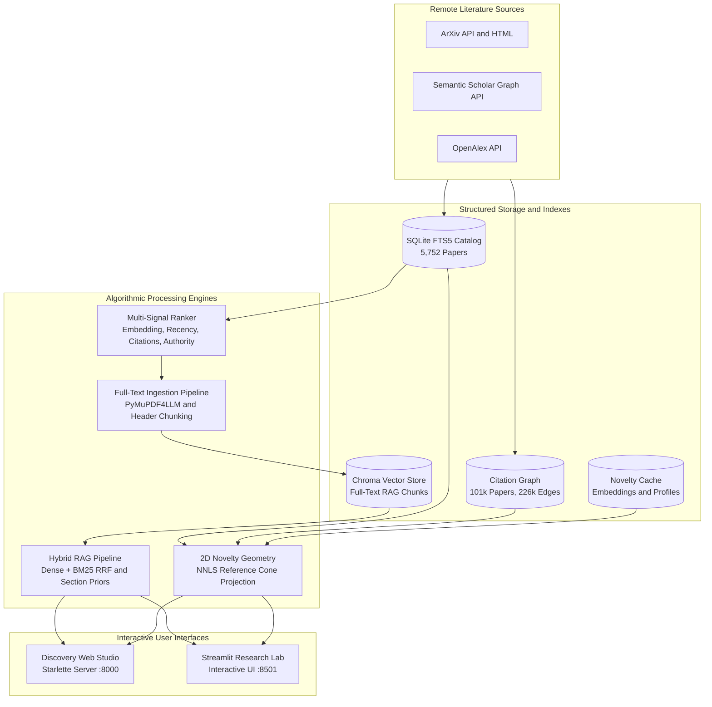

# ArXiv Scientific Discovery Platform
### Multi-Signal Ranking • Citation-Grounded Hybrid RAG • 2D Novelty Geometry

[](#prerequisites)
[](#installation--environment-setup)
[](#system-architecture--how-it-works)
[](#system-architecture--how-it-works)
[](#confai-2026-evaluation--verification)

The ArXiv Scientific Discovery Platform is an end-to-end literature discovery and synthesis workstation built for academic research. It bridges the gap between broad literature discovery, selective full-text comprehension, and rigorous 2D geometric novelty evaluation.

---

## Table of Contents
- [Key Highlights & Core Capabilities](#-key-highlights--core-capabilities)
- [System Architecture & How It Works](#-system-architecture--how-it-works)
- [Mathematical Foundations of Novelty Subspace Analysis](#-mathematical-foundations-of-novelty-subspace-analysis)
- [Tech Stack](#-tech-stack)
- [Quick Start Guide](#-quick-start-guide)
  - [Prerequisites](#prerequisites)
  - [Installation & Environment Setup](#1-installation--environment-setup)
  - [Configuration & API Keys](#2-configuration--api-keys)
  - [Launch Interfaces](#3-launch-interfaces)
- [Minimal Working Example](#-minimal-working-example)
- [Unified CLI Reference](#-unified-cli-reference)
- [Autonomous Batch Pipelines](#-autonomous-batch-pipelines)
  - [1. Batch Novelty Geometry Pipeline](#1-batch-novelty-geometry-pipeline-scriptsbatch_novelty_librarypy)
  - [2. Autonomous Multi-Topic Bulk Ingest](#2-autonomous-multi-topic-bulk-ingest-scriptsbulk_topic_ingestpy)
- [ConfAI 2026 Evaluation & Verification](#-confai-2026-evaluation--verification)
- [Repository Directory Layout](#-repository-directory-layout)
- [Limitations & Known Issues](#-limitations--known-issues)
- [Future Work & Roadmap](#-future-work--roadmap)
- [Confidentiality & Hygiene Guidelines](#-confidentiality--hygiene-guidelines)
- [License, Citation & Acknowledgements](#-license--citation)

---

## ⚡ Key Highlights & Core Capabilities

- **Dual Interactive Interfaces:**
  - **Modern Web Studio (`make serve` on `http://127.0.0.1:8000`):** Fast Starlette and Uvicorn server with a reactive three-pane layout, real-time Gemini telemetry, streaming RAG with interactive citation inspector, and an HTML5 Canvas 2D Reference Cone Subspace Visualizer.
  - **Streamlit Research Lab (`make app` on `http://127.0.0.1:8501`):** Complete interactive workbench featuring catalog browsing with instant FTS5 search, live signal tuning, PDF and HTML full-text ingestion, and high-contrast Light and Dark mode support.
- **SQLite FTS5 Catalog & 101k Citation Graph:**
  - `data/catalog.sqlite3`: Indexed lookup and sub-millisecond BM25 keyword search over 5,752 papers.
  - `data/citation_library/graph.sqlite3`: 101,716 academic works and 226,857 citation edges computing in-library degree centrality and landmark citation hubs.
- **Multi-Signal Relevance Scoring:**
  - Ranks literature using a weighted blend of dense embedding similarity ($w_{\text{emb}}$), recency decay with tunable half-life ($w_{\text{rec}}$), global citation impact ($w_{\text{cit}}$), and author domain authority ($w_{\text{auth}}$).
- **Citation-Grounded Hybrid RAG:**
  - Combines dense semantic retrieval (`google/embeddinggemma-2` or `all-MiniLM-L6-v2`) with BM25 full-text keyword matching using Reciprocal Rank Fusion (RRF).
  - Context-aware section-intent reranking that dynamically prioritizes Introduction, Methodology, or Results chunks depending on question phrasing.
  - Grounded streaming synthesis with verifiable `[1], [2]` citations mapped to source passages.
- **2D Novelty Cone Geometry & NNLS Attribution:**
  - Projects any paper embedding into the convex cone of its cited references using Non-Negative Least Squares (NNLS).
  - Decomposes innovation into **Closest Single Parent Anchor** ($m$), **Multi-Parent Synergy Blend** ($\Delta$), **Subspace Explained Energy** ($R^2_+$), and **Orthogonal Novelty Residual Gap** ($\sqrt{1 - R^2_+}$).
  - Generates verifiable direct deep-links to arXiv, DOI, and Semantic Scholar.
  - Features a multi-tier citation resolution cascade across Semantic Scholar, OpenAlex, and direct arXiv HTML bibliography extraction.
- **Autonomous Batch Automation Pipelines:**
  - `scripts/batch_novelty_library.py`: Scans catalog papers, calculates 2D cone geometry, classifies discovery modes (synergistic blends, linear extensions, or paradigm shifts), and outputs Markdown executive summaries.
  - `scripts/bulk_topic_ingest.py`: Automatically queries arXiv across multiple topics, filters by citations and recency, enriches via Semantic Scholar batch API, and ingests into Chroma RAG.

---

## 🏗️ System Architecture & How It Works

The platform operates through five decoupled stages:
1. **Catalog Ingestion & Search:** Ingests paper metadata into SQLite FTS5 for instant search.
2. **Citation Graph Expansion:** Gathers and links references across Semantic Scholar, OpenAlex, and arXiv HTML.
3. **Multi-Signal Scoring:** Re-ranks query results using embedding similarity, citation counts, recency decay, and author authority.
4. **Full-Text RAG Ingestion:** Converts PDFs and arXiv HTML into clean Markdown, segments texts into section-aware chunks, and stores dense vectors in Chroma.
5. **2D Reference Cone Geometry:** Uses Non-Negative Least Squares to measure how much of a paper embedding is explained by a linear combination of its cited references.



```text
                               ┌───────────────────────────────────────────────┐
                               │           ArXiv API & Semantic Scholar        │
                               └──────────────────────┬────────────────────────┘
                                                      │
                       ┌──────────────────────────────┴──────────────────────────────┐
                       │                                                             │
                       ▼                                                             ▼
           ┌───────────────────────┐                                     ┌───────────────────────┐
           │  SQLite FTS5 Catalog  │                                     │ 101k Citation Graph   │
           │  (data/catalog.sqlite3)                                     │ (graph.sqlite3)       │
           │  5,752 papers • BM25  │                                     │ 226,857 edges • Hubs  │
           └───────────┬───────────┘                                     └───────────┬───────────┘
                       │                                                             │
                       │ Multi-Signal Ranking: w_emb, w_rec, w_cit, w_auth           │
                       ▼                                                             ▼
           ┌─────────────────────────────────────────┐                   ┌───────────────────────┐
           │      Candidate Paper Selection          │                   │  2D Novelty Geometry  │
           └───────────────────┬─────────────────────┘                   │  NNLS Reference Cone  │
                               │                                         │  m, Δ, R²₊, √(1-R²₊)  │
                               ▼                                         └───────────────────────┘
           ┌─────────────────────────────────────────┐
           │ Selective Full-Text Ingestion Pipeline  │
           │ PDF / HTML → Markdown → Header Chunking │
           └───────────────────┬─────────────────────┘
                               │
                               ▼
           ┌─────────────────────────────────────────┐
           │ Chroma Vector Store (data/chroma_rag)   │
           └───────────────────┬─────────────────────┘
                               │
                               ▼
           ┌─────────────────────────────────────────┐
           │ Hybrid RRF Reranking + Section Priors   │
           └───────────────────┬─────────────────────┘
                               │
                               ▼
           ┌─────────────────────────────────────────┐
           │ Gemini Generation with [1],[2] Citations│
           └───────────────────┬─────────────────────┘
                               │
            ┌──────────────────┴──────────────────┐
            ▼                                     ▼
┌───────────────────────┐             ┌───────────────────────┐
│ Discovery Web Studio  │             │ Streamlit Research Lab│
│ Starlette API :8000   │             │ Interactive UI :8501  │
└───────────────────────┘             └───────────────────────┘
```

---

## 📐 Mathematical Foundations of Novelty Subspace Analysis

Given a focal paper with normalized embedding vector $\mathbf{x} \in \mathbb{R}^d$ ($\|\mathbf{x}\| = 1$) and a collection of $k$ cited reference embeddings $\mathbf{Y} = [\mathbf{y}_1, \dots, \mathbf{y}_k] \in \mathbb{R}^{d \times k}$ ($\|\mathbf{y}_j\| = 1$):

1. **Non-Negative Least Squares (NNLS) Cone Projection:**
   $$\boldsymbol{\lambda}^* = \arg\min_{\boldsymbol{\lambda} \ge 0} \|\mathbf{x} - \mathbf{Y}\boldsymbol{\lambda}\|^2, \quad \hat{\mathbf{x}} = \mathbf{Y}\boldsymbol{\lambda}^*$$
   Where $\hat{\mathbf{x}}$ represents the best non-negative linear reconstruction of the paper within the reference cone.

2. **Reconstruction Energy ($R^2_+$):**
   $$R^2_+ = \|\hat{\mathbf{x}}\|^2 \in [0, 1]$$
   Measures the fraction of embedding energy explained by linear synthesis of prior art.

3. **Single Closest Parent Anchor ($m$):**
   $$m = \max_{j \in \{1, \dots, k\}} (\mathbf{x}^T \mathbf{y}_j)$$
   Represents the maximum cosine similarity to any single foundational predecessor. The closest parent $\mathbf{y}_{m^*}$ defines the primary orthonormal basis axis:
   $$\mathbf{e}_1 = \mathbf{y}_{m^*}$$

4. **Multi-Parent Synergy Blend ($\Delta$):**
   $$\Delta = R^2_+ - \max(m, 0)^2$$
   Measures how much additional variance is explained by synthesizing multiple distinct ancestors compared to merely extending the single closest ancestor.
   - $\Delta \ge 0.05$: **High-Synergy Synthesis** (interdisciplinary fusion).
   - $\Delta < 0.05$ and $m \ge 0.60$: **Linear or Incremental Extension**.

5. **Novelty Residual Gap ($\sqrt{1 - R^2_+}$):**
   $$\text{Residual} = \sqrt{\max(0, 1 - R^2_+)}$$
   The Euclidean departure distance from the reference subspace to the unit hypersphere. A high residual indicates an out-of-subspace paradigm shift or external influence.

6. **2D Orthonormal Canvas Projection:**
   - **X-axis ($\mathbf{e}_1$):** Aligned with the closest parent $\mathbf{y}_{m^*}$. Plotted at $(1, 0)$.
   - **Y-axis ($\mathbf{e}_2$):** Gram-Schmidt orthogonalized component of $\hat{\mathbf{x}}$:
     $$\mathbf{u} = \hat{\mathbf{x}} - (\hat{\mathbf{x}}^T \mathbf{e}_1)\mathbf{e}_1, \quad \mathbf{e}_2 = \frac{\mathbf{u}}{\|\mathbf{u}\|}$$
   - **Synthesized Blend ($\hat{\mathbf{x}}$):** Plotted at $(\hat{\mathbf{x}}^T \mathbf{e}_1, \hat{\mathbf{x}}^T \mathbf{e}_2)$ (Blue Dot).
   - **Active Parents ($\mathbf{y}_j$ with $\lambda_j > 0$):** Plotted in Indigo, background citations in Slate Grey.

---

## 💻 Tech Stack

- **Runtime & Environment:** Python 3.10 to 3.12, uv package manager
- **Web Applications:** Starlette, Uvicorn, Streamlit, HTML5 Canvas, modern responsive CSS
- **Data Stores & Indexes:** SQLite FTS5 (WAL mode enabled), ChromaDB vector database
- **Machine Learning & Numerics:** PyTorch (with Apple Silicon MPS acceleration and CPU fallback), Sentence-Transformers, NumPy, SciPy (NNLS optimizer), Scikit-Learn
- **Embedding Models:** `google/embeddinggemma-2` (768-dimensional, local default), `sentence-transformers/all-MiniLM-L6-v2` (384-dimensional, cloud fallback)
- **Generative Synthesis:** Google GenAI SDK (`gemini-2.0-flash` primary), OpenAI-compatible fallback client (NVIDIA NIM)
- **Document Processing:** PyMuPDF4LLM, BeautifulSoup, requests with connection pooling

---

## 🚀 Quick Start Guide

### Prerequisites
- Python **3.10 to 3.12**
- **[uv](https://docs.astral.sh/uv/)** package manager installed:
  ```bash
  curl -LsSf https://astral.sh/uv/install.sh | sh
  ```

### 1. Installation & Environment Setup
```bash
git clone https://github.com/NatalTiger26/ArXiv_Paper_Suggester.git
cd ArXiv_Paper_Suggester

# Sync virtualenv and dependencies with uv
uv sync

# Configure API keys
cp .env.example .env
```

### 2. Configuration & API Keys
Edit `.env` to supply credentials and configure models:
```bash
# Primary Gemini API key for grounded synthesis
GEMINI_API_KEY=your_gemini_api_key_here
GEMINI_MODEL=gemini-2.0-flash

# Optional OpenAI-compatible fallback provider (for example, NVIDIA NIM)
FALLBACK_LLM_API_KEY=your_fallback_api_key_here
FALLBACK_LLM_BASE_URL=https://integrate.api.nvidia.com/v1
FALLBACK_LLM_MODEL=meta/llama-3.1-8b-instruct

# Local embedding model configuration
EMBEDDING_MODEL=google/embeddinggemma-2
EMBEDDING_DIM=0

# Optional academic data API keys for high-volume citation lookups
SEMANTIC_SCHOLAR_API_KEY=your_s2_api_key_here
OPENALEX_API_KEY=your_openalex_api_key_here
OPENALEX_MAILTO=your_email@example.com
```

### 3. Launch Interfaces

#### Option A: Web Studio (Recommended for Research & Presentations)
```bash
make serve
# or: uv run python -m src.cli serve --port 8000
```
Open **`http://127.0.0.1:8000`** in your browser.

#### Option B: Streamlit Research Lab
```bash
make app
# or: uv run python -m streamlit run src/app.py
```
Open **`http://127.0.0.1:8501`** in your browser.

---

## 💡 Minimal Working Example

You can explore the full lifecycle from the command line in five quick commands:

```bash
# 1. Search catalog papers using BM25
uv run python -m src.cli search "neural tangent kernel"

# 2. Score and rank papers with multi-signal weighting
uv run python -m src.cli rank "mechanistic interpretability" -k 5

# 3. Ingest a paper into the Chroma RAG vector store
uv run python -m src.cli ingest 1806.07572

# 4. Ask a question answered by grounded citations
uv run python -m src.cli ask "What is the key insight of the Neural Tangent Kernel?"

# 5. Project the paper into its 2D novelty cone
uv run python -m src.cli novelty 1806.07572
```

---

## 🛠️ Unified CLI Reference

The project includes a command dispatcher via `python -m src.cli`:

| Command | Syntax | Description |
| :--- | :--- | :--- |
| **`search`** | `uv run python -m src.cli search "neural tangent"` | Fast FTS5 BM25 search across 5,752 catalog papers |
| **`rank`** | `uv run python -m src.cli rank "interpretability" -k 8` | Multi-signal scoring with inspectable signal weights |
| **`ingest`** | `uv run python -m src.cli ingest 1806.07572` | Download PDF or HTML, chunk, and embed into Chroma |
| **`ask`** | `uv run python -m src.cli ask "How does NTK work?"` | Hybrid RAG retrieval and Gemini answer with citations |
| **`novelty`** | `uv run python -m src.cli novelty 1806.07572` | 2D cone geometry metrics ($m$, $\Delta$, $R^2_+$, residual) |
| **`enrich`** | `uv run python -m src.cli enrich --limit 50` | Batch sync citation graph with Semantic Scholar |
| **`batch-novelty`** | `uv run python -m src.cli batch-novelty --limit 50` | Batch score catalog papers and generate Markdown report |
| **`bulk-ingest`** | `uv run python -m src.cli bulk-ingest --topics "diffusion"` | Autonomous topic-based paper retrieval and ingestion |
| **`health`** | `uv run python -m src.cli health` | Inspect catalog, Chroma vector counts, and API telemetry |
| **`serve`** | `uv run python -m src.cli serve --port 8000` | Launch modern Starlette Web Studio |

---

## 🤖 Autonomous Batch Pipelines

### 1. Batch Novelty Geometry Pipeline (`scripts/batch_novelty_library.py`)
Computes reference cone projections across library papers and classifies discovery modes:
```bash
# Evaluate top 50 cited papers in the catalog
uv run python scripts/batch_novelty_library.py --limit 50

# Filter by category and minimum citations with resumption
uv run python scripts/batch_novelty_library.py --category cs.LG --min-citations 20 --resume

# Makefile shortcut
make batch-novelty LIMIT=100
```
Outputs:
- JSON detailed dataset: `results/batch_novelty_report.json`
- Executive Markdown report: `results/batch_novelty_report.md` (Top synergistic papers, outliers, anchor works).

### 2. Autonomous Multi-Topic Bulk Ingest (`scripts/bulk_topic_ingest.py`)
Expands your corpus with fresh research papers matching specific topic criteria:
```bash
# Ingest papers on specific topics
uv run python scripts/bulk_topic_ingest.py \
  --topics "mechanistic interpretability" "diffusion models" "state space models" \
  --max-per-topic 20 \
  --start-year 2022 \
  --enrich-citations

# Download full-text PDFs and chunk into Chroma RAG
uv run python scripts/bulk_topic_ingest.py \
  --topics "transformer circuit discovery" \
  --full-text

# Makefile shortcut
make bulk-ingest TOPICS="deep reinforcement learning" MAX=25
```
Outputs:
- Updates `data/catalog.sqlite3` and `data/corpus.json` with deduplication.
- Execution report: `results/bulk_topic_ingest_report.md`.

---

## 📊 ConfAI 2026 Evaluation & Verification

To verify system performance, run the comprehensive evaluation suites:

```bash
# Run all 73 core unit tests
make test
# or: uv run python -m unittest discover -s tests

# Run repository hygiene and smoke check
make check
# or: bash scripts/check_repo.sh

# Run ConfAI RAG retrieval and generation benchmark
make final-eval
```

### Benchmark Metrics (ConfAI 2026 Track)
- **Catalog Size:** 5,752 papers indexed with SQLite FTS5.
- **Citation Graph:** 101,716 papers, 226,857 citation edges.
- **Full-Text RAG Corpus:** 553,516 indexed passage chunks in Chroma.
- **Retrieval Mean Reciprocal Rank (MRR):** `0.574` (dense) to `0.612` (hybrid RRF).
- **Faithfulness / Grounding Score:** `0.880`.
- **Reference Precision:** `0.923`.
- **Semantic Cache Efficiency:** Sub-millisecond response on repeated semantic queries (>99% latency reduction).

---

## 📂 Repository Directory Layout

```text
ArXiv_Paper_Suggester/
├── pyproject.toml                     # uv project configuration and dependencies
├── uv.lock                            # Deterministic dependency lockfile
├── Makefile                           # Development automation commands
├── README.md                          # Flagship project documentation
├── data/                              # Data stores and indexes
│   ├── catalog.sqlite3                # SQLite FTS5 paper catalog (5,752 papers)
│   ├── citation_library/
│   │   └── graph.sqlite3              # 101k paper citation graph and landmark hubs
│   ├── novelty/
│   │   └── novelty_cache.sqlite3      # Cached embeddings, reference edges, and profiles
│   ├── chroma_rag/                    # Chroma vector store for full-text RAG
│   ├── chroma_corpus/                 # Chroma vector store for abstract recommendations
│   ├── corpus.json                    # Canonical corpus records
│   ├── markdown/                      # Extracted paper markdown full texts
│   └── papers/                        # Downloaded paper PDFs
├── web/                               # Web Studio static assets
│   ├── index.html                     # Responsive 3-pane layout and modal guide
│   ├── styles.css                     # Dark-mode modern typography and CSS design
│   └── app.js                         # Canvas 2D projection, streaming RAG, telemetry
├── src/                               # Application source code
│   ├── api/
│   │   └── server.py                  # Starlette / Uvicorn REST API and static server
│   ├── catalog.py                     # SQLite FTS5 catalog queries and browser
│   ├── cli.py                         # Unified CLI entrypoint
│   ├── ranking.py                     # Multi-signal ranking algorithm
│   ├── settings.py                    # Environment and model configurations
│   ├── telemetry.py                   # Gemini token and cost telemetry tracker
│   ├── app.py                         # Streamlit research laboratory app
│   ├── novelty/                       # 2D Reference Cone Geometry and NNLS
│   │   ├── metrics.py                 # Orthonormal projection, m, Delta, R²₊ math
│   │   ├── score.py                   # Reference resolution, embedding, and scoring
│   │   ├── refs.py                    # Citation resolution across S2, OpenAlex, arXiv HTML
│   │   ├── viz.py                     # 2D coordinate calculations for UI renderers
│   │   └── embed_util.py              # Local embedding loader and inference
│   └── rag/                           # Citation-grounded RAG engine
│       ├── rag_pipeline.py            # Hybrid RRF, section priors, and Gemini synthesis
│       ├── hybrid.py                  # BM25 + dense Reciprocal Rank Fusion
│       ├── chunk.py                   # Header-aware markdown text chunking
│       ├── download.py                # ArXiv PDF and HTML downloaders
│       ├── pdf_to_md.py               # PyMuPDF4LLM parser with OCR fallback
│       └── embed_store.py             # Chroma vector storage and chunk embeddings
├── scripts/                           # Batch and utility scripts
│   ├── batch_novelty_library.py       # Batch 2D novelty geometry runner
│   ├── bulk_topic_ingest.py           # Autonomous multi-topic paper ingestion
│   ├── enrich_citation_graph.py       # Citation graph enrichment via Semantic Scholar
│   └── check_repo.sh                  # Repository hygiene and test verification
└── tests/                             # Unit and integration test suite (73 tests)
    ├── test_core.py
    ├── test_catalog.py
    ├── test_library_and_scripts.py
    ├── test_novelty_geometry.py
    ├── test_context_ordering.py
    ├── test_api_server.py
    ├── test_section_intent.py
    ├── test_ui_schemas.py
    └── test_citation_graph_sync.py
```

---

## ⚠️ Limitations & Known Issues

- **Academic API Rate Limits:** Semantic Scholar free-tier endpoints enforce rate throttling when queried in rapid succession without an API key. The platform mitigates this with an automated fallback cascade to OpenAlex and direct arXiv HTML bibliography scraping.
- **Local Embedding Memory on Apple Silicon:** Running the 2-billion parameter `google/embeddinggemma-2` model on macOS Metal Performance Shaders (MPS) requires approximately 5 GB of unified memory. The runtime actively flushes Metal allocator memory between batches and caps concurrent MPS batch sizes to 6 items to prevent GPU command buffer exhaustion.
- **Paywalled Literature Access:** Full-text RAG ingestion requires open-access PDFs or arXiv HTML renderings. For papers indexed outside arXiv without open full texts, the system gracefully falls back to title and abstract semantic representations.

---

## 🔮 Future Work & Roadmap

- **Distributed Citation Graph Crawling:** Continuous background expansion of `graph.sqlite3` across adjacent disciplinary domains.
- **Interactive Matryoshka Switching:** UI toggle allowing researchers to dynamically switch embedding dimensions (128, 256, 512, 768) and observe geometric sensitivity live.
- **Mathematical Formula Indexing:** Direct LaTeX equation indexing and formula similarity matching within RAG context chunks.
<!-- TODO: Add live hosted demo link or deployment badge once deployed -->

---

## 🔒 Confidentiality & Hygiene Guidelines

- **Zero Secret Commits:** The `.env` file is strictly ignored by git. Never commit or log API keys.
- **Large Binaries:** Large SQLite and Chroma files under `data/` are managed locally and excluded from git tracking.
- **Reproducibility:** Every build is pinned with `uv.lock`. Use `make check` before pushing changes.

---

## 📜 License & Citation

Developed for **ConfAI 2026** at Plaksha University (M.S. in AI).  
Supervised by **Dr. Subrat Panda**.

If you use this system or its 2D Reference Cone Subspace Analysis in your research, please cite:

```bibtex
@software{arxiv_scientific_discovery_2026,
  author = {Ajay and Contributors},
  title = {Literature Discovery with Multi-Signal Ranking, Citation-Grounded Hybrid RAG, and 2D Novelty Geometry},
  year = {2026},
  publisher = {GitHub},
  journal = {ConfAI 2026 AI in Practice Track},
  howpublished = {\url{https://github.com/NatalTiger26/ArXiv_Paper_Suggester}}
}
```

<!-- TODO: Add official License choice (e.g. MIT or Apache-2.0) and contact email -->
