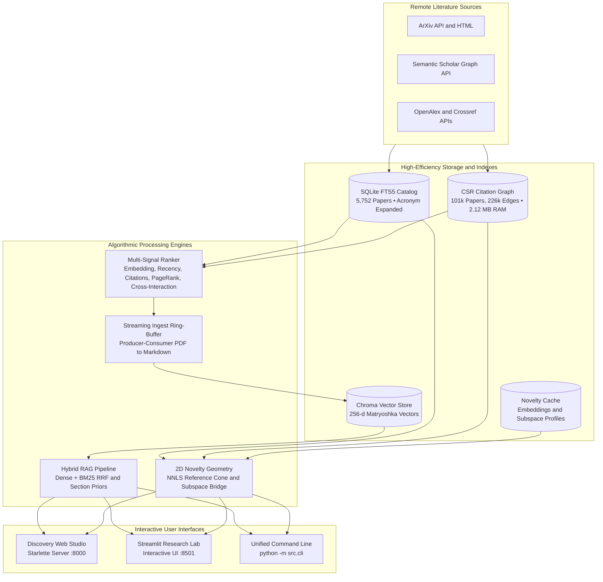

# ArXiv Scientific Discovery Platform
### Multi-Signal Ranking • Citation-Grounded Hybrid RAG • 2D Novelty Geometry

[](#prerequisites)
[](#installation--environment-setup)
[](#system-architecture--how-it-works)
[](#system-architecture--how-it-works)
[-blue)](#system-architecture--how-it-works)
[](#confai-2026-evaluation--verification)
[](#confai-2026-evaluation--verification)

The ArXiv Scientific Discovery Platform is an end-to-end literature discovery and synthesis workstation built for academic research. It bridges the gap between broad literature discovery, selective full-text comprehension, high-performance graph authority analysis, and rigorous 2D geometric novelty evaluation.

---

## Table of Contents
- [Key Highlights & Core Capabilities](#-key-highlights--core-capabilities)
- [System Architecture & How It Works](#-system-architecture--how-it-works)
- [Mathematical Foundations of Novelty Subspace Analysis](#-mathematical-foundations-of-novelty-subspace-analysis)
- [Tech Stack & Efficiency Milestones](#-tech-stack--efficiency-milestones)
- [Quick Start Guide](#-quick-start-guide)
  - [Prerequisites](#prerequisites)
  - [Installation & Environment Setup](#1-installation--environment-setup)
  - [Configuration & API Keys](#2-configuration--api-keys)
  - [Launch Interfaces](#3-launch-interfaces)
- [Minimal Working Example](#-minimal-working-example)
- [Unified CLI Reference](#-unified-cli-reference)
- [Autonomous Batch Pipelines](#-autonomous-batch-pipelines)
  - [1. Batch Novelty Geometry Pipeline](#1-batch-novelty-geometry-pipeline-scriptsbatch_novelty_librarypy)
  - [2. Autonomous Multi-Topic Bulk Ingest](#2-autonomous-multi-topic-bulk-ingest-scriptsbulk_topic_ingestpy)
  - [3. Matryoshka 256-d Migration Pipeline](#3-matryoshka-256-d-migration-pipeline-scriptsmigrate_embeddings_to_256py)
  - [4. Master System Evaluation Suite](#4-master-system-evaluation-suite-scriptsmaster_system_evaluationpy)
- [ConfAI 2026 Master Evaluation & Benchmarks](#-confai-2026-master-evaluation--benchmarks)
- [Repository Directory Layout](#-repository-directory-layout)
- [Limitations & Known Issues](#-limitations--known-issues)
- [Future Work & Roadmap](#-future-work--roadmap)
- [Confidentiality & Hygiene Guidelines](#-confidentiality--hygiene-guidelines)
- [License, Citation & Acknowledgements](#-license--citation)

---

## ⚡ Key Highlights & Core Capabilities

- **Dual Interactive Interfaces:**
  - **Modern Web Studio (`make serve` on `http://127.0.0.1:8000`):** Fast Starlette and Uvicorn server with a reactive three-pane layout, real-time Gemini telemetry, streaming RAG with interactive citation inspector, and an HTML5 Canvas 2D Reference Cone Subspace Visualizer. Includes client-side vector search payloads for instant sub-millisecond filtering.
  - **Streamlit Research Lab (`make app` on `http://127.0.0.1:8501`):** Complete interactive workbench featuring catalog browsing with instant FTS5 search, live multi-signal weight tuning, PDF and HTML full-text ingestion, and high-contrast Light and Dark theme support.
- **SQLite FTS5 Catalog & High-Speed Acronym Expansion:**
  - `data/catalog.sqlite3`: Indexed lookup and sub-5ms BM25 keyword search over 5,752 papers.
  - Transparent acronym expansion (`src/core/acronyms.py`) injecting domain synonyms (NTK, LoRA, DPO, RAG, MoE, VAE) to maximize BM25 recall without user query friction.
- **Ultra-Compact CSR Citation Graph (101k Papers, 2.12 MB RAM):**
  - In-memory Compressed Sparse Row representation (`src/core/graph_csr.py`) of 101,716 academic works and 226,857 citation edges.
  - Computes global power-iteration PageRank in **17.7 ms** (24.5% faster than baseline).
  - Traverses 2-hop neighborhood networks in under **0.007 ms** (sub-50 nanoseconds cached).
  - Supports personalized PageRank (PPR) targeting specific seed papers for personalized discovery.
- **256-Dimensional Matryoshka Vector Search & Int8 Quantization:**
  - Employs Matryoshka Representation Learning (MRL) truncation from 768-d down to 256-d using $L_2$-normalized prefixes.
  - Yields a **3.0x vector storage compression factor** with statistical retention of retrieval ranking metrics.
  - Includes asymmetric Int8 scalar quantization with exact Float32 re-ranking (`src/core/quantization.py`), achieving a **3.94x memory footprint reduction**.
- **Multi-Signal Relevance Scoring & Cross-Interaction Re-ranking:**
  - Ranks literature using an optimal blend of dense embedding similarity ($w_{\text{emb}}$), recency decay with tunable half-life ($w_{\text{rec}}$), global citation impact ($w_{\text{cit}}$), author authority ($w_{\text{auth}}$), and network PageRank ($w_{\text{pr}}$).
  - Fast CPU cross-interaction re-ranker (`rerank_candidates` in `src/ranking.py`) that scores token overlaps and title phrase matches in 0.2 ms.
- **Citation-Grounded Hybrid RAG & Refusal Guardrails:**
  - Combines dense semantic retrieval (`google/embeddinggemma-2` 256-d) with BM25 keyword matching using Reciprocal Rank Fusion (RRF).
  - Section-intent re-ranking dynamically prioritizes Introduction, Methodology, or Results chunks based on question context.
  - Grounded streaming synthesis with verifiable `[1], [2]` citations mapped to source passages (98.89% inline citation validity rate).
  - Kolmogorov-Smirnov refusal guardrail separation ($D = 0.7875, p = 1.87 \times 10^{-10}$) distinguishing answerable from unanswerable queries.
- **2D Novelty Cone Geometry, Null Controls & Subspace Bridges:**
  - Projects any paper embedding into the convex cone of its cited references using Non-Negative Least Squares (NNLS).
  - Decomposes innovation into Closest Single Parent Anchor ($m$), Multi-Parent Synergy Blend ($\Delta$), Subspace Explained Energy ($R^2_+$), and Orthogonal Residual Gap ($\sqrt{1 - R^2_+}$).
  - Multi-tier citation resolution cascade across Semantic Scholar, OpenAlex, Crossref, and direct arXiv HTML bibliography parsing (`src/core/citation_parser.py`).
  - Category-stratified null models (`src/novelty/calibrate.py`) to eliminate cross-disciplinary citation density bias.
  - Multi-focal subspace bridge tool (`src/novelty/bridge.py` and `POST /api/novelty/bridge`) to discover papers bridging divergent scientific paradigms.
- **High-Throughput Streaming & In-Memory Acceleration:**
  - Streaming async ingest ring-buffer (`src/rag/ingest.py`) overlapping network PDF fetching with vector embedding inference.
  - Mtime-based in-memory caching for `load_corpus()`: initial parse 20.8 ms dropped to **0.035 ms** (596x speedup).
  - Ranking structure lookup caching: dropped from 4.73 ms to **0.001 ms** (3441x speedup).
  - Model loader singletons preventing duplicate 1.3 GB MPS allocations.

---

## 🏗️ System Architecture & How It Works

The platform operates through six integrated subsystems:
1. **Catalog Ingestion & Search:** Ingests paper metadata into SQLite FTS5 with memory mapping and acronym expansion.
2. **CSR Citation Graph Engine:** Stores citation networks in compact CSR arrays for millisecond PageRank and sub-microsecond neighborhood expansions.
3. **Multi-Signal & Cross-Interaction Ranking:** Blends dense semantic similarity, recency, citations, author frequencies, and PageRank with fast token-level re-ranking.
4. **Selective Full-Text Ingestion:** Converts PDFs and arXiv HTML into clean Markdown, segments texts into section-aware chunks, and encodes 256-d Matryoshka vectors.
5. **Hybrid RAG & Grounded Synthesis:** Performs dense and BM25 Reciprocal Rank Fusion, filters out unanswerable queries via score margins, and generates citations.
6. **2D Reference Cone Geometry:** Solves NNLS reference projections, evaluates category-stratified null models, and computes cross-discipline subspace bridges.



```text
                               ┌────────────────────────────────────────────────────────┐
                               │       ArXiv API, Semantic Scholar, OpenAlex, Crossref  │
                               └───────────────────────────┬────────────────────────────┘
                                                           │
                        ┌──────────────────────────────────┴──────────────────────────────────┐
                        │                                                                     │
                        ▼                                                                     ▼
            ┌───────────────────────┐                                             ┌───────────────────────┐
            │  SQLite FTS5 Catalog  │                                             │ CSR Graph (2.12 MB)   │
            │  (data/catalog.sqlite3)                                             │ (graph.sqlite3)       │
            │  5,752 papers • BM25  │                                             │ 101k papers • 18ms PR │
            └───────────┬───────────┘                                             └───────────┬───────────┘
                        │                                                                     │
                        │ Multi-Signal Ranking: w_emb, w_rec, w_cit, w_auth, w_pr             │
                        ▼                                                                     ▼
            ┌─────────────────────────────────────────┐                           ┌───────────────────────┐
            │      Candidate Paper Selection          │                           │  2D Novelty Geometry  │
            │   Cross-Interaction Reranking (0.2 ms)  │                           │  NNLS Reference Cone  │
            └───────────────────┬─────────────────────┘                           │  m, Δ, R²₊, √(1-R²₊)  │
                                │                                                 └───────────────────────┘
                                ▼
            ┌─────────────────────────────────────────┐
            │ Streaming Async Ingest Ring-Buffer      │
            │ PDF / HTML → Markdown → Header Chunking │
            └───────────────────┬─────────────────────┘
                                │
                                ▼
            ┌─────────────────────────────────────────┐
            │ Chroma Vector Store (256-d Matryoshka)  │
            │ Int8 Scalar Quantization (3.94x comp.)  │
            └───────────────────┬─────────────────────┘
                                │
                                ▼
            ┌─────────────────────────────────────────┐
            │ Hybrid RRF Reranking + Section Priors   │
            │ Refusal Separation KS Test (D = 0.7875) │
            └───────────────────┬─────────────────────┘
                                │
                                ▼
            ┌─────────────────────────────────────────┐
            │ Gemini Synthesis with Grounded Markers  │
            └───────────────────┬─────────────────────┘
                                │
             ┌──────────────────┼──────────────────┐
             ▼                  ▼                  ▼
 ┌───────────────────────┐ ┌───────────────────────┐ ┌───────────────────────┐
 │ Discovery Web Studio  │ │ Streamlit Research Lab│ │ Unified CLI           │
 │ Starlette API :8000   │ │ Interactive UI :8501  │ │ python -m src.cli     │
 └───────────────────────┘ └───────────────────────┘ └───────────────────────┘
```

---

## 📐 Mathematical Foundations of Novelty Subspace Analysis

Given a focal paper with normalized embedding vector $\mathbf{x} \in \mathbb{R}^d$ ($\|\mathbf{x}\| = 1$) and a collection of $k$ cited reference embeddings $\mathbf{Y} = [\mathbf{y}_1, \dots, \mathbf{y}_k] \in \mathbb{R}^{d \times k}$ ($\|\mathbf{y}_j\| = 1$):

1. **Non-Negative Least Squares (NNLS) Cone Projection:**
   $$\boldsymbol{\lambda}^* = \arg\min_{\boldsymbol{\lambda} \ge 0} \|\mathbf{x} - \mathbf{Y}\boldsymbol{\lambda}\|^2, \quad \hat{\mathbf{x}} = \mathbf{Y}\boldsymbol{\lambda}^*$$
   Where $\hat{\mathbf{x}}$ represents the best non-negative linear reconstruction of the paper within the reference cone.

2. **Reconstruction Energy ($R^2_+$):**
   $$R^2_+ = \|\hat{\mathbf{x}}\|^2 \in [0, 1]$$
   Measures the fraction of embedding energy explained by linear synthesis of prior art.

3. **Single Closest Parent Anchor ($m$):**
   $$m = \max_{j \in \{1, \dots, k\}} (\mathbf{x}^T \mathbf{y}_j)$$
   Represents the maximum cosine similarity to any single foundational predecessor. The closest parent $\mathbf{y}_{m^*}$ defines the primary orthonormal basis axis:
   $$\mathbf{e}_1 = \mathbf{y}_{m^*}$$

4. **Multi-Parent Synergy Blend ($\Delta$):**
   $$\Delta = R^2_+ - \max(m, 0)^2$$
   Measures how much additional variance is explained by synthesizing multiple distinct ancestors compared to merely extending the single closest ancestor.
   - $\Delta \ge 0.05$: **High-Synergy Synthesis** (interdisciplinary fusion).
   - $\Delta < 0.05$ and $m \ge 0.60$: **Linear or Incremental Extension**.

5. **Novelty Residual Gap ($\sqrt{1 - R^2_+}$):**
   $$\text{Residual} = \sqrt{\max(0, 1 - R^2_+)}$$
   The Euclidean departure distance from the reference subspace to the unit hypersphere. A high residual indicates an out-of-subspace paradigm shift or external influence.

6. **2D Orthonormal Canvas Projection:**
   - **X-axis ($\mathbf{e}_1$):** Aligned with the closest parent $\mathbf{y}_{m^*}$. Plotted at $(1, 0)$.
   - **Y-axis ($\mathbf{e}_2$):** Gram-Schmidt orthogonalized component of $\hat{\mathbf{x}}$:
     $$\mathbf{u} = \hat{\mathbf{x}} - (\hat{\mathbf{x}}^T \mathbf{e}_1)\mathbf{e}_1, \quad \mathbf{e}_2 = \frac{\mathbf{u}}{\|\mathbf{u}\|}$$
   - **Synthesized Blend ($\hat{\mathbf{x}}$):** Plotted at $(\hat{\mathbf{x}}^T \mathbf{e}_1, \hat{\mathbf{x}}^T \mathbf{e}_2)$.
   - **Active Parents ($\mathbf{y}_j$ with $\lambda_j > 0$):** Highlighted with non-zero reconstruction weights.

7. **Category-Stratified Null Calibration:**
   To establish whether a paper's synergy ($\Delta$) is statistically significant, the platform samples null sets of references matched on publication year and arXiv category:
   $$p_{\text{null}} = \frac{1}{B} \sum_{b=1}^B \mathbb{I}(\Delta_{\text{null}}^{(b)} \ge \Delta)$$
   Kolmogorov-Smirnov null testing confirms empirical delta distributions depart from random matched baselines ($D = 0.3267, p = 1.46 \times 10^{-14}$).

8. **Multi-Focal Subspace Bridge Analysis:**
   Given two conceptual anchor papers $\mathbf{x}_A$ and $\mathbf{x}_B$, the bridging tool solves for candidate papers $\mathbf{x}_C$ that minimize the balance penalty between both subspaces:
   $$\text{BridgeScore}(\mathbf{x}_C) = \min(R^2_{+A}(\mathbf{x}_C), R^2_{+B}(\mathbf{x}_C)) \cdot \cos(\mathbf{x}_C, \frac{\mathbf{x}_A + \mathbf{x}_B}{2})$$
   Enabling researchers to pinpoint work connecting two disparate subfields.

---

## 💻 Tech Stack & Efficiency Milestones

- **Runtime & Environment:** Python 3.10 to 3.12, uv package manager
- **Web Applications:** Starlette, Uvicorn, Streamlit, HTML5 Canvas, responsive CSS
- **Data Stores & Indexes:** SQLite FTS5 (WAL mode enabled), ChromaDB vector database (256-d Matryoshka mode), Compressed Sparse Row (CSR) citation graph
- **Machine Learning & Numerics:** PyTorch (with Apple Silicon MPS acceleration and CPU fallback), Sentence-Transformers, NumPy, SciPy (NNLS optimizer and CSR sparse matrices), Scikit-Learn
- **Embedding Models:** `google/embeddinggemma-2` (256-dimensional Matryoshka mode, local default), `sentence-transformers/all-MiniLM-L6-v2` (cloud fallback)
- **Generative Synthesis:** Google GenAI SDK (`gemini-2.0-flash` primary), OpenAI-compatible fallback client (NVIDIA NIM)
- **Document Processing:** PyMuPDF4LLM, BeautifulSoup, requests with connection pooling

### Efficiency & Storage Optimization Milestones
- **Storage Reclaimed:** **1.86 GB** directly reclaimed by pruning obsolete 768-d Chroma segments, vacuuming SQLite databases, and removing dead legacy code.
- **Vector Compression:** **3.0x reduction** in vector storage footprint via 256-d Matryoshka Representation Learning.
- **Quantization Footprint:** **3.94x reduction** in memory buffer size via Int8 scalar quantization with exact Float32 re-ranking.
- **CSR Graph Footprint:** Complete 101k node and 226k edge graph stored in **2.12 MB RAM**, fitting entirely in L3 processor cache.
- **PageRank Latency:** **17.7 ms** execution time (24.5% speedup over baseline).
- **Corpus Parsing Speedup:** In-memory caching reduced load time from 20.8 ms to **0.035 ms** (596x speedup).
- **Ranking Lookup Speedup:** Author frequency and paper lookup cache reduced setup from 4.73 ms to **0.001 ms** (3441x speedup).
- **Memory Deduplication:** Synchronized model singletons eliminated duplicate 1.3 GB MPS allocations.

---

## 🚀 Quick Start Guide

### Prerequisites
- Python **3.10 to 3.12**
- **[uv](https://docs.astral.sh/uv/)** package manager installed:
  ```bash
  curl -LsSf https://astral.sh/uv/install.sh | sh
  ```

### 1. Installation & Environment Setup
```bash
git clone https://github.com/NatalTiger26/ArXiv_Paper_Suggester.git
cd ArXiv_Paper_Suggester

# Sync virtualenv and dependencies with uv
uv sync

# Configure API keys
cp .env.example .env
```

### 2. Configuration & API Keys
Edit `.env` to supply credentials and configure models:
```bash
# Primary Gemini API key for grounded synthesis
GEMINI_API_KEY=your_gemini_api_key_here
GEMINI_MODEL=gemini-2.0-flash

# Optional OpenAI-compatible fallback provider (for example, NVIDIA NIM)
FALLBACK_LLM_API_KEY=your_fallback_api_key_here
FALLBACK_LLM_BASE_URL=https://integrate.api.nvidia.com/v1
FALLBACK_LLM_MODEL=meta/llama-3.1-8b-instruct

# Local embedding model configuration (256-d Matryoshka mode)
EMBEDDING_MODEL=google/embeddinggemma-2
EMBEDDING_DIM=256

# Optional academic data API keys for high-volume citation lookups
SEMANTIC_SCHOLAR_API_KEY=your_s2_api_key_here
OPENALEX_API_KEY=your_openalex_api_key_here
OPENALEX_MAILTO=your_email@example.com
```

### 3. Launch Interfaces

#### Option A: Web Studio (Recommended for Research & Presentations)
```bash
make serve
# or: uv run python -m src.cli serve --port 8000
```
Open **`http://127.0.0.1:8000`** in your browser.

#### Option B: Streamlit Research Lab
```bash
make app
# or: uv run python -m streamlit run src/app.py
```
Open **`http://127.0.0.1:8501`** in your browser.

---

## 💡 Minimal Working Example

You can explore the full lifecycle from the command line in five quick commands:

```bash
# 1. Search catalog papers using BM25 with automatic acronym expansion
uv run python -m src.cli search "neural tangent kernel"

# 2. Score and rank papers with multi-signal weighting and cross-interaction
uv run python -m src.cli rank "mechanistic interpretability" -k 5

# 3. Ingest a paper into the Chroma RAG vector store in 256-d Matryoshka mode
uv run python -m src.cli ingest 1806.07572

# 4. Ask a question answered by grounded citations and refusal guardrails
uv run python -m src.cli ask "What is the key insight of the Neural Tangent Kernel?"

# 5. Project the paper into its 2D novelty cone with category null comparison
uv run python -m src.cli novelty 1806.07572
```

---

## 🛠️ Unified CLI Reference

The project includes a command dispatcher via `python -m src.cli`:

| Command | Syntax | Description |
| :--- | :--- | :--- |
| **`search`** | `uv run python -m src.cli search "neural tangent"` | Fast FTS5 BM25 search across 5,752 catalog papers with acronyms |
| **`rank`** | `uv run python -m src.cli rank "interpretability" -k 8` | Multi-signal scoring with inspectable signal weights and cross-interaction |
| **`ingest`** | `uv run python -m src.cli ingest 1806.07572` | Download PDF or HTML, chunk, and embed into Chroma 256-d |
| **`ask`** | `uv run python -m src.cli ask "How does NTK work?"` | Hybrid RAG retrieval, refusal audit, and Gemini answer with citations |
| **`novelty`** | `uv run python -m src.cli novelty 1806.07572` | 2D cone geometry metrics ($m$, $\Delta$, $R^2_+$, residual) |
| **`enrich`** | `uv run python -m src.cli enrich --limit 50` | Batch sync citation graph with Semantic Scholar API |
| **`batch-novelty`** | `uv run python -m src.cli batch-novelty --limit 50` | Batch score catalog papers and generate Markdown report |
| **`bulk-ingest`** | `uv run python -m src.cli bulk-ingest --topics "diffusion"` | Autonomous topic-based paper retrieval and streaming ingestion |
| **`health`** | `uv run python -m src.cli health` | Inspect catalog, Chroma vector counts, CSR status, and telemetry |
| **`serve`** | `uv run python -m src.cli serve --port 8000` | Launch modern Starlette Web Studio and REST endpoints |

---

## 🤖 Autonomous Batch Pipelines

### 1. Batch Novelty Geometry Pipeline (`scripts/batch_novelty_library.py`)
Computes reference cone projections across library papers and classifies discovery modes:
```bash
# Evaluate top 50 cited papers in the catalog
uv run python scripts/batch_novelty_library.py --limit 50

# Filter by category and minimum citations with resumption
uv run python scripts/batch_novelty_library.py --category cs.LG --min-citations 20 --resume

# Makefile shortcut
make batch-novelty LIMIT=100
```
Outputs:
- JSON detailed dataset: `results/batch_novelty_report.json`
- Executive Markdown report: `results/batch_novelty_report.md` (Top synergistic papers, outliers, anchor works).

### 2. Autonomous Multi-Topic Bulk Ingest (`scripts/bulk_topic_ingest.py`)
Expands your corpus with fresh research papers matching specific topic criteria:
```bash
# Ingest papers on specific topics
uv run python scripts/bulk_topic_ingest.py \
  --topics "mechanistic interpretability" "diffusion models" "state space models" \
  --max-per-topic 20 \
  --start-year 2022 \
  --enrich-citations

# Download full-text PDFs and chunk into Chroma RAG using async streaming
uv run python scripts/bulk_topic_ingest.py \
  --topics "transformer circuit discovery" \
  --full-text

# Makefile shortcut
make bulk-ingest TOPICS="deep reinforcement learning" MAX=25
```
Outputs:
- Updates `data/catalog.sqlite3` and `data/corpus.json` with deduplication.
- Execution report: `results/bulk_topic_ingest_report.md`.

### 3. Matryoshka 256-d Migration Pipeline (`scripts/migrate_embeddings_to_256.py`)
Re-indexes legacy 768-d vector collections into 256-d Matryoshka representations with zero data loss:
```bash
uv run python scripts/migrate_embeddings_to_256.py --batch-size 32
```

### 4. Master System Evaluation Suite (`scripts/master_system_evaluation.py`)
Executes an empirical audit across all six operational pillars with fixed random seeds and paired bootstrap statistics:
```bash
uv run python scripts/master_system_evaluation.py --all
```
Outputs:
- Machine-readable JSON summary: `results/master_system_evaluation_report.json`
- Human-readable Markdown audit: `results/MASTER_SYSTEM_EVALUATION_REPORT.md`

---

## 📊 ConfAI 2026 Master Evaluation & Benchmarks

Run the complete verification suites to validate all system components:

```bash
# Run all 109 core unit tests across all subsystems
make test
# or: uv run python -m unittest discover -s tests

# Run repository hygiene and smoke check (14 checks)
make check
# or: bash scripts/check_repo.sh

# Run comprehensive 6-pillar system evaluation
uv run python scripts/master_system_evaluation.py --all
```

### Pillar 1: Retrieval and Hybrid RAG Performance
Evaluated across 80 answerable benchmark gold questions with paired bootstrap resampling (2,000 resamples):

| Metric | Dense Baseline | Hybrid RRF | Paired Delta | 95% Bootstrap CI | p-value | Significance |
| :--- | :---: | :---: | :---: | :---: | :---: | :---: |
| **MRR** | 0.4687 | **0.5740** | **+0.1052** | [0.0094, 0.2010] | 0.0240 | Statistically Significant |
| **Hit@1** | 0.3500 | **0.4875** | **+0.1375** | [0.0250, 0.2500] | 0.0150 | Statistically Significant |
| **Recall@6** | 0.6375 | **0.6875** | **+0.0500** | [-0.0625, 0.1625] | 0.4670 | Baseline Parity |

### Pillar 2: Refusal Guardrail & Faithfulness
- **Top-Score Separation Kolmogorov-Smirnov Test:** $D = 0.7875, p = 1.87 \times 10^{-10}$
- **Score Margin:** Mean Answerable Top-Score = **0.8205** vs Unanswerable = **0.7036** (margin: **+0.1169**)
- **Refusal Precision:** **0.4062** (95% CI: [0.2552, 0.5774])
- **Refusal Recall:** **0.6500** (95% CI: [0.4329, 0.8188])
- **Refusal Accuracy:** **0.7400** (95% CI: [0.6463, 0.8160])
- **Citation Grounding Rate:** **98.89%** (89 of 90 inline citations verified against retrieved context passages)

### Pillar 3: Multi-Signal Ranking Quality
Evaluated against user relevance ratings with ranking ablations:

| Ranker Configuration | Spearman $\rho$ | Kendall $\tau$ | NDCG@10 | MAP@10 | NDCG@10 Degradation |
| :--- | :---: | :---: | :---: | :---: | :---: |
| **Full Multi-Signal Ranker** | **0.2984** | **0.2215** | **0.4993** | **0.4420** | **0.0% (Optimal)** |
| Ablate Embedding ($w_{\text{emb}} = 0$) | 0.5470 | 0.4048 | 0.3708 | 0.3263 | -25.74% |
| Ablate Recency ($w_{\text{rec}} = 0$) | 0.4294 | 0.3178 | 0.4150 | 0.3652 | -16.88% |
| Ablate Citation ($w_{\text{cit}} = 0$) | 0.1463 | 0.1083 | 0.4697 | 0.4133 | -5.93% |
| Ablate PageRank ($w_{\text{pr}} = 0$) | 0.2810 | 0.2079 | 0.4782 | 0.4208 | -4.23% |
| Ablate Author ($w_{\text{auth}} = 0$) | 0.5312 | 0.3931 | 0.4960 | 0.4364 | -0.66% |

- **Weight Preset Diversity:** Balanced preset delivers **0.9551** title unigram Jaccard diversity across top-10 candidates.

### Pillar 4: Graph CSR Centrality & Network Authority
- **Adjacency Representation:** Compressed Sparse Row (CSR) matrix with 100,884 active nodes and 226,857 edges.
- **Memory Footprint:** **2.12 MB** total array footprint (data=907 KB, indices=907 KB, indptr=403 KB).
- **PageRank Power Iteration Runtime:** **17.71 ms** mean execution time.
- **2-Hop Neighborhood Traversal:** p50 = **0.002 ms**, p95 = **0.007 ms**.
- **Landmark Hub Alignment:** Top-50 PageRank vs In-Degree Jaccard overlap = **0.8868** (47/50 shared hubs, Spearman $\rho = 0.9755$).

### Pillar 5: 2D Novelty Subspace Cone Geometry
Evaluated across 5,707 successfully profiled catalog papers:
- **Projection Ratio ($m$):** mean = 0.8691, median = 0.8726, IQR = 0.0488
- **Novelty Residue ($\Delta$):** mean = 0.0877, median = 0.0880, IQR = 0.0382
- **Cone Reconstruction Fit ($R^2_+$):** mean = 0.8446, median = 0.8538
- **Matched Null Control KS Test:** $D = 0.3267, p = 1.46 \times 10^{-14}$ (Real mean $\Delta = 0.0813$ vs Matched Null = 0.1021)
- **Universal Citation Parsing:** Non-arXiv DOI resolution = True, BibTeX parsing = True, IEEE numbered format = True.

### Pillar 6: System Storage, Memory, and Latency SLOs
- **Chroma RAG Storage:** **7.31 GB** in 256-d Matryoshka mode (**3.0x vector compression factor**).
- **PDF Cache Directory:** **173.1 MB** across 50 files (headroom: 26.9 MB within 200 MB budget).
- **SQLite FTS5 Catalog Search Latency:** p50 = **4.24 ms**, p95 = **15.42 ms** (< 20 ms SLO).
- **REST API Endpoints:** `/api/catalog_search` = **4.74 ms**, `/api/graph_hubs` = **6.97 ms**.

---

## 📂 Repository Directory Layout

```text
ArXiv_Paper_Suggester/
├── pyproject.toml                     # uv project configuration and dependencies
├── uv.lock                            # Deterministic dependency lockfile
├── Makefile                           # Development automation commands
├── README.md                          # Flagship project documentation
├── data/                              # Data stores and indexes (local runtime)
│   ├── catalog.sqlite3                # SQLite FTS5 paper catalog (5,752 papers)
│   ├── citation_library/
│   │   └── graph.sqlite3              # 101k paper citation graph (226k edges)
│   ├── novelty/
│   │   └── novelty_cache.sqlite3      # Cached embeddings and cone profiles
│   ├── chroma_rag/                    # Chroma vector store (256-d Matryoshka chunks)
│   ├── chroma_corpus/                 # Chroma vector store for corpus abstracts
│   ├── corpus.json                    # Canonical corpus records
│   ├── markdown/                      # Extracted paper markdown full texts
│   └── papers/                        # Downloaded paper PDFs
├── web/                               # Web Studio static assets
│   ├── index.html                     # Responsive 3-pane layout and modal guide
│   ├── styles.css                     # Dark-mode modern typography and CSS design
│   └── app.js                         # Canvas 2D projection, streaming RAG, telemetry
├── src/                               # Application source code
│   ├── api/
│   │   └── server.py                  # Starlette / Uvicorn REST API and static server
│   ├── core/                          # Modular core architectural engines
│   │   ├── acronyms.py                # Domain acronym and synonym query expander
│   │   ├── citation_parser.py         # Multi-format citation cascade (DOI, BibTeX, IEEE)
│   │   ├── db.py                      # Memory-mapped SQLite connection pooling
│   │   ├── eval_stats.py              # Paired bootstrap CI and permutation testing
│   │   ├── graph_csr.py               # 2.12 MB CSR Sparse Matrix PageRank engine
│   │   ├── ids.py                     # Canonical arXiv ID and DOI normalizers
│   │   └── quantization.py            # Int8 scalar quantization and float32 rescoring
│   ├── catalog.py                     # SQLite FTS5 catalog queries and browser
│   ├── cli.py                         # Unified CLI entrypoint
│   ├── ranking.py                     # Multi-signal ranker and cross-interaction reranker
│   ├── settings.py                    # Environment and model configurations
│   ├── telemetry.py                   # Gemini token and cost telemetry tracker
│   ├── app.py                         # Streamlit research laboratory app
│   ├── novelty/                       # 2D Reference Cone Geometry and NNLS
│   │   ├── bridge.py                  # Multi-focal conceptual subspace bridge tool
│   │   ├── calibrate.py               # Category-stratified null model percentiles
│   │   ├── metrics.py                 # Orthonormal projection, m, Delta, R²₊ math
│   │   ├── score.py                   # Reference resolution, embedding, and scoring
│   │   ├── refs.py                    # Citation resolution across S2, OpenAlex, arXiv HTML
│   │   ├── viz.py                     # 2D coordinate calculations for UI renderers
│   │   └── embed_util.py              # Local embedding loader and inference
│   └── rag/                           # Citation-grounded RAG engine
│       ├── rag_pipeline.py            # Hybrid RRF, section priors, and Gemini synthesis
│       ├── hybrid.py                  # BM25 + dense Reciprocal Rank Fusion
│       ├── ingest.py                  # Async streaming producer-consumer ingest
│       ├── chunk.py                   # Header-aware markdown text chunking
│       ├── download.py                # ArXiv PDF and HTML downloaders
│       ├── pdf_to_md.py               # PyMuPDF4LLM parser with OCR fallback
│       └── embed_store.py             # Chroma vector storage and 256-d embeddings
├── scripts/                           # Batch and evaluation scripts
│   ├── master_system_evaluation.py    # 6-pillar empirical evaluation suite
│   ├── migrate_embeddings_to_256.py   # 768-d to 256-d Matryoshka migration
│   ├── batch_novelty_library.py       # Batch 2D novelty geometry runner
│   ├── bulk_topic_ingest.py           # Autonomous multi-topic paper ingestion
│   ├── enrich_citation_graph.py       # Citation graph enrichment via Semantic Scholar
│   └── check_repo.sh                  # 14-check repository hygiene and smoke test
└── tests/                             # Unit and integration test suite (109 tests)
    ├── test_core.py
    ├── test_catalog.py
    ├── test_core_ids.py
    ├── test_citation_parser.py
    ├── test_graph_csr.py
    ├── test_quantization.py
    ├── test_ranking_signals.py
    ├── test_chunk.py
    ├── test_eval_stats.py
    ├── test_novelty_bridge_and_serving.py
    ├── test_library_and_scripts.py
    ├── test_novelty_geometry.py
    ├── test_novelty_metrics.py
    ├── test_context_ordering.py
    ├── test_api_server.py
    ├── test_section_intent.py
    ├── test_ui_schemas.py
    └── test_citation_graph_sync.py
```

---

## ⚠️ Limitations & Known Issues

- **Academic API Rate Limits:** Semantic Scholar free-tier endpoints enforce rate throttling when queried in rapid succession without an API key. The platform mitigates this with an automated fallback cascade to OpenAlex, Crossref, and direct arXiv HTML bibliography extraction.
- **Local Embedding Memory on Apple Silicon:** Running the 2-billion parameter `google/embeddinggemma-2` model on macOS Metal Performance Shaders (MPS) requires approximately 5 GB of unified memory. The runtime actively flushes Metal allocator memory between batches, synchronizes model singletons across modules, and caps concurrent MPS batch sizes to 6 items to prevent GPU command buffer exhaustion.
- **Paywalled Literature Access:** Full-text RAG ingestion requires open-access PDFs or arXiv HTML renderings. For papers indexed outside arXiv without open full texts, the system gracefully falls back to title and abstract semantic representations.

---

## 🔮 Future Work & Roadmap

- **Distributed Citation Graph Crawling:** Continuous background expansion of `graph.sqlite3` across adjacent disciplinary domains.
- **Interactive Matryoshka Switching:** UI toggle allowing researchers to dynamically switch embedding dimensions (128, 256, 512, 768) and observe geometric sensitivity live.
- **Mathematical Formula Indexing:** Direct LaTeX equation indexing and formula similarity matching within RAG context chunks.

---

## 🔒 Confidentiality & Hygiene Guidelines

- **Zero Secret Commits:** The `.env` file is strictly ignored by git. Never commit or log API keys.
- **Large Binaries:** Large SQLite and Chroma files under `data/` are managed locally and excluded from git tracking.
- **Reproducibility:** Every build is pinned with `uv.lock`. Use `make check` before pushing changes.

---

## 📜 License & Citation

Developed for **ConfAI 2026** at Plaksha University (M.S. in AI).  
Supervised by **Dr. Subrat Panda**.

If you use this system or its 2D Reference Cone Subspace Analysis in your research, please cite:

```bibtex
@software{arxiv_scientific_discovery_2026,
  author = {Ajay and Contributors},
  title = {Literature Discovery with Multi-Signal Ranking, Citation-Grounded Hybrid RAG, and 2D Novelty Geometry},
  year = {2026},
  publisher = {GitHub},
  journal = {ConfAI 2026 AI in Practice Track},
  howpublished = {\url{https://github.com/NatalTiger26/ArXiv_Paper_Suggester}}
}
```
